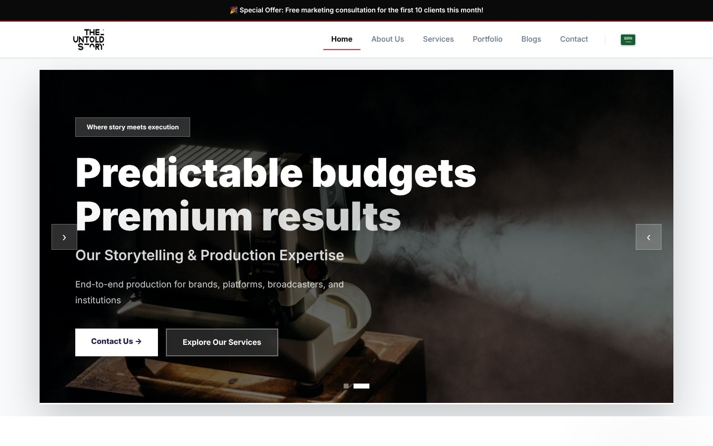
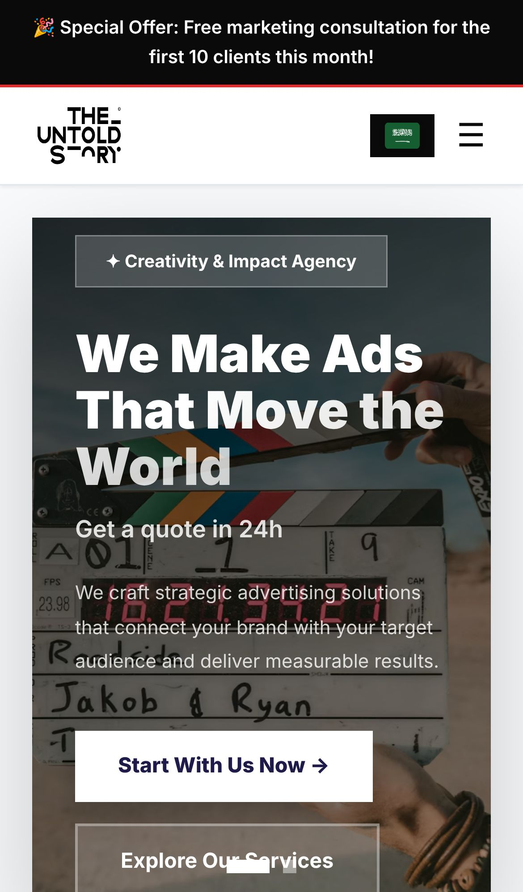
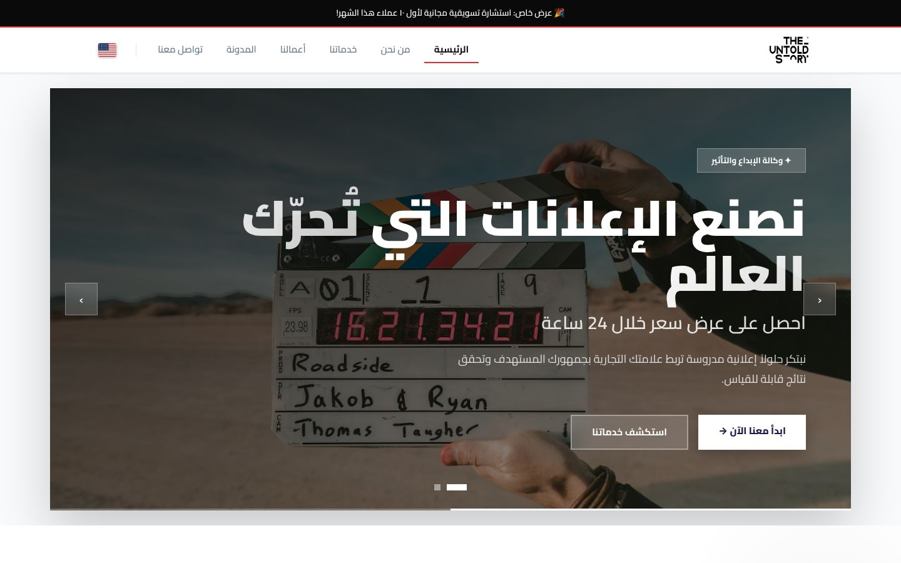

<div align="center">

# The Untold Story

### Bilingual (English / Arabic RTL) website for a film and video production studio

Marketing website for **The Untold Story**, a full-service film and video production studio working across Egypt and the MENA region. Built with Next.js 16, React 19 and TypeScript, with a custom English / Arabic language switch.

[](https://nextjs.org)
[](https://react.dev)
[](https://www.typescriptlang.org)
[](https://tailwindcss.com)
[](https://lucide.dev)
<br>
[](https://advertising-blond.vercel.app)

**[Live demo](https://advertising-blond.vercel.app)** ·
**[Portfolio](https://new-portfolio-ashy-xi.vercel.app/)** ·
**[LinkedIn](https://www.linkedin.com/in/eslamraafat-dev/)** ·
**[Email](mailto:eslamraafat736@gmail.com)**

<br>



</div>

<table>
  <tr>
    <td width="33%"></td>
    <td width="67%"></td>
  </tr>
  <tr>
    <td align="center"><sub>Mobile (iPhone 13)</sub></td>
    <td align="center"><sub>Arabic RTL version (language switch in the header)</sub></td>
  </tr>
</table>

---

## Contents

- [Overview](#overview)
- [Features](#features)
- [Tech stack](#tech-stack)
- [Pages](#pages)
- [Project structure](#project-structure)
- [Getting started](#getting-started)
- [Deployment](#deployment)
- [Author](#author)

## Overview

The site presents the studio's services (film, commercials, documentaries, corporate content, TV, podcasts, photography and original IP), its work, team, offices and contact options. Every page is available in English and Arabic, and the layout mirrors to right-to-left when Arabic is selected.

All copy describes the studio's real services, offices and contact details. Where the studio has not published material yet, the site says so instead of inventing it: the **Our Work** page shows the production types the studio delivers (no client names, budgets or results), and the **News & Insights** cards are topic previews marked "Coming soon".

## Features

### Bilingual EN / AR with RTL

- A `LanguageContext` provider holds the current locale and all translations ([`app/lib/data.ts`](app/lib/data.ts)).
- Switching language sets `lang` and `dir` on `<html>`, so the whole layout flips between LTR and RTL. The choice is saved in `localStorage`.
- Arabic text uses the Cairo font and English uses Inter.

### Home page

- Auto-playing hero carousel (changes slide every 5.5 seconds) with previous / next controls and slide indicators.
- Animated statistics counters that start when they scroll into view (`IntersectionObserver`) and format numbers for the active locale.
- Work showcase, awards / recognition strip, services overview and an FAQ accordion.
- Scroll-reveal animations through a small reusable `Reveal` component.

### Other pages

- **Our Work (`/portfolio`):** production types (commercials, documentaries, corporate, live, post production, localization) with category filters.
- **News & Insights (`/blog`):** topic previews with working tag filters and a mailing-list sign-up.
- **Contact:** a form with a three-step progress indicator and office cards. The form validates on the client (name, email format, message length) with accessible inline errors, then opens the visitor's email app with a pre-filled message to the studio (`mailto:`). There is no mail backend, so the success screen says "ready to send" and offers a direct email link, rather than claiming the message was sent. The quote form on `/services` and the mailing-list box work the same way.

### SEO

- Root metadata with a title template, description, canonical URLs, Open Graph / Twitter tags and Organization JSON-LD; each route has its own title, description and canonical.
- `app/sitemap.ts` and `app/robots.ts` generate `/sitemap.xml` and `/robots.txt` (the dashboard and API are disallowed).
- The site URL comes from [`app/lib/site.ts`](app/lib/site.ts): `NEXT_PUBLIC_SITE_URL`, then Vercel's production domain, then the known production URL. It never falls back to `localhost`.

### Editable content (demo dashboard)

- `GET /api/ads` serves the editable hero / announcement content from [`app/lib/db.json`](app/lib/db.json), and the language provider merges it over the built-in translations. Public requests only receive that content.
- The unlisted `/dashboard` (marked `noindex`) shows sample overview data and lets an admin edit the hero content through `POST /api/ads`.
- Access control ([`app/lib/admin.ts`](app/lib/admin.ts)): in development everything is open so the demo works locally. In production the dashboard data and `POST /api/ads` require the `ADMIN_TOKEN` environment variable, sent as the `x-admin-token` header (the dashboard asks for it) or an `admin_token` cookie. Without `ADMIN_TOKEN` the dashboard shows a "Dashboard disabled" notice and editing returns `401`.
- Saving writes to the JSON file, which only works where the file system is writable (locally). On Vercel the API answers `503` with a clear message.

## Tech stack

| Layer | Tools |
| --- | --- |
| Framework | Next.js 16.2 (App Router), React 19.2 |
| Language | TypeScript 5 |
| Styling | Tailwind CSS 4 (`@tailwindcss/postcss`), CSS custom properties for the brand colours |
| Icons | lucide-react, flag-icons (CDN) |
| Images | `next/image` |
| Fonts | Inter, Cairo (Google Fonts) |
| Data | Route handler (`app/api/ads/route.ts`) reading a JSON file, token-protected writes |
| Quality | ESLint 9 (`eslint-config-next`) |
| Hosting | Vercel |

## Pages

| Route | Page |
| --- | --- |
| `/` | Home: hero carousel, stats, work showcase, awards, services, FAQ |
| `/about` | Studio story, values and leadership team |
| `/services` | Production services |
| `/portfolio` | Our Work: production types with category filters |
| `/blog` | News & Insights: topic previews and mailing-list sign-up |
| `/contact` | Contact form (mailto) and office details |
| `/dashboard` | Unlisted demo dashboard (`noindex`, needs `ADMIN_TOKEN` in production) |
| `/sitemap.xml`, `/robots.txt` | Generated by `app/sitemap.ts` and `app/robots.ts` |

## Project structure

```text
.
├── app/
│   ├── layout.tsx            # root layout: Navbar, Footer, LanguageProvider
│   ├── page.tsx              # home page
│   ├── about/ services/ portfolio/ blog/ contact/ dashboard/
│   ├── api/ads/route.ts      # GET content, POST edits (admin only)
│   ├── sitemap.ts robots.ts  # generated sitemap.xml and robots.txt
│   ├── components/           # Navbar, Footer, HeroCarousel, AnimatedStats, AwardsSection,
│   │                         # WorkShowcase, Reveal, LanguageContext
│   ├── lib/
│   │   ├── data.ts           # EN / AR translations and page content
│   │   ├── db.json           # editable content used by /api/ads
│   │   ├── site.ts           # site URL, name and shared metadata
│   │   ├── admin.ts          # ADMIN_TOKEN check for the dashboard / API
│   │   └── contact.ts        # form validation and mailto builder
│   └── globals.css           # Tailwind 4 + theme variables
└── public/                   # logos (black.png, white.png)
```

## Getting started

**Requirements:** Node.js 20.9 or newer and npm.

```bash
git clone https://github.com/Eslamraafat1/Advertising.git
cd Advertising
npm install
npm run dev        # http://localhost:3000
```

Optional environment variables (see [`.env.example`](.env.example)):

| Variable | Purpose |
| --- | --- |
| `NEXT_PUBLIC_SITE_URL` | Public URL for canonical links, sitemap and robots. Defaults to the Vercel production domain. |
| `ADMIN_TOKEN` | Enables the dashboard and content editing in production. Leave unset to keep them disabled. |

| Command | What it does |
| --- | --- |
| `npm run dev` | Start the dev server |
| `npm run build` | Production build |
| `npm run start` | Serve the production build |
| `npm run lint` | Run ESLint |

## Deployment

The site is deployed on **Vercel**: [advertising-blond.vercel.app](https://advertising-blond.vercel.app). Pushes to `main` redeploy it. No environment variables are required; set `ADMIN_TOKEN` in the Vercel project only if you want the dashboard unlocked there.

## Author

**Eslam Raafat** — Front-End Developer (React / Next.js / TypeScript)

- **Portfolio:** [new-portfolio-ashy-xi.vercel.app](https://new-portfolio-ashy-xi.vercel.app/)
- **LinkedIn:** [linkedin.com/in/eslamraafat-dev](https://www.linkedin.com/in/eslamraafat-dev/)
- **GitHub:** [@Eslamraafat1](https://github.com/Eslamraafat1)
- **Email:** [eslamraafat736@gmail.com](mailto:eslamraafat736@gmail.com)

---

© The Untold Story. Brand name and logo belong to The Untold Story. Code shared for portfolio purposes.
